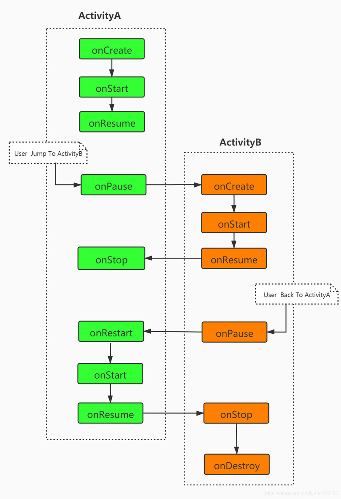

## day: 2.21
1. 学习了 kotlin语法中
    inline、noinline、crossinline 的概念作用
2. ViewModel
   - 学习了ViewModel的概念，具有长生命周期 及 在Activity旋转保持 数据不变的原理
     基本原理是：在Application的onCreate钩子函数调用时，调用startKoin创建ViewModel的BeanDefination工厂类。
     - （Activity、Fragment等）相关组件实现了ViewModelStoreOwner接口，在懒加载获取viewModel时，使用为ViewModelStoreOwner扩展的高级函数::viewModel<T>()，
       构建ViewModelProvider，
       - 通过provider的get(key,clazz)获取ViewModel实例；
         - 首先查看传入的vmStore中是否存在该key的viewModel，否则调用ViewModelProvider::factory的create方法，
           - 从koinContext的get方法中，instanceRegistry查找，然后将功能下发给beanRegistry->searchByClass()::
           - 通过definitions获取一个BeanDefination,而这个defination在koin的初始化时被添加至definations中；
           - 最终通过definitions::invoke(参数)创建
3. Application
      - BIND_APPLICATION消息=>handleBindApplication()
        -attachBaseContext经历的调用流程 ->LoadedApk::makeApplicationInner()-> Instrumentation::newApplication(classLoader,className, context)-> app.attach()->attachBaseContext()
        - onCreate经历的调用流程 -> Instrumentation::callApplicationOnCreate(app)->app.onCreate()
4. 在一个Activity中启动另一个Activity经历的生命周期，onCreate->onStart->onResume()
     
5. Activity的四种启动模式
        - Standard
        - SingleTop
        - SingleInstance
        - SingleTask
    - 处于不同启动模式下，发生跳转的生命周期变化，特别点在于SingleTop和SingleInstance onNewIntent()->onResume()

## day: 2.22 回溯了day21对于koin及ViewModel梳理回滚，RecycleView的布局（LayoutManager）和缓存（Recycler） 进行了一场面试

    面试中掌握不足的有 
     1. ANR 的概念，检测机制，线上发生ANR如何监控；
     2. 算法题： 
        - 根据前序遍历和后序遍历还原二叉树；
        - 股票交易问题： p121、p122

     > 2026-10-07 补充：第 1 点已补齐 —— 见
     > [`稳定性监控/INTERVIEW-稳定性监控.md`](app/src/main/java/com/interview/稳定性监控/INTERVIEW-稳定性监控.md)
     > （ANR 的三条采集通道 + 真机实测的判据/阈值/诚实边界），
     > 配套可跑实验页 `StabilityLabActivity`（见同目录 `README.md`）。
     >
     > 2026-10-08 补充：该问题里「**线上如何监控**」的后半段（采集之后的上报管道、
     > 服务端聚合口径、告警与成本）单独成篇 ——
     > [`稳定性监控/INTERVIEW-线上ANR监控方案.md`](app/src/main/java/com/interview/稳定性监控/INTERVIEW-线上ANR监控方案.md)。
     > 内含本次真机新测的数字（ExitInfo 16 条只覆盖 **2h41m**；一条 ANR trace
     > 未压缩 **196 KB** / gzip **28 KB**），以及审计出的 **4 处接线缺口**
     > （其中「ExitInfo 回捞结果从未进上报管道」会让线上拿不到权威 ANR 证据）。

## day 2.23 先应付完工作， 在处理下算法题，之后看自定义View

    自定义View 构造函数中的第三、四个参数（详见笔记）
        defStyleAttr: 与主题相关的概念，该style定义在themes.xml中，不被系统主动调用
        defSytleRes: 定义在styles.xml中一套属性的默认值，当attrs及defStyleAttr都没有定位到该属性时，走这里

## day 2.26 leetcode刷题(股票交易——最多可以操作k次（牢记构造状态-》状态转移-》确定初始值-》确定返回值）、二叉树的遍历（前中后序，都通过颜色标记法）)、自定义view的onMeasure方法

## day 2.27 leetcode刷题

    1. 二叉树重建，
        1. 根据中序遍历和后序遍历
        2. 根据中序遍历和先序遍历 

# day 2.28

    - leetcode 哈希-异位词分组
    - 自定义viewGroup全流程完成
        总结：对于ViewGroup考虑 onMeasure + onLayout， 
            onMeasure中：大部分的场景下都是需要先通过度量孩子的宽高之后获取parent的宽高；【child的度量】
                        在确定孩子宽高时，通过parent的measureSpec、padding和child的layoutParams确定child的measureSpec
                            父布局EXACTLY、UNSPECIFIED、AT_MOST + 子布局的WRAP_CONTENT、MATCH_PARENT、>0的dp =》 确定
                        父布局宽高确定 【父布局的度量】
                            通过需求场景确定，如在流式布局中通过child的宽度+间距 累加 与parent的宽度进行比较 确定每一行的元素数目，为onLayout做准备；
                            高度通过child的摆放行数 + 间距 确定；
            onLayout中：
                    对children按照measure中写入的每一行的顺序，整理 left、top、right、bottom 调用child的layout方法完成排部。

## 2026-10-11 三方 SDK 治理工具（四维度）

需求：① 确定每个 SDK 声明/真实使用哪些权限，没用怎么移除 ② 依赖重复与版本冲突
③ 体积降低方向 ④ 三方 SDK 线程滥用治理。

产出（新增，非文档而是能跑出报告的**工具**）：

- [`docs/sdk-governance.md`](docs/sdk-governance.md) —— 设计说明 + 使用手册 + 面试答题稿
- [`build-logic/sdk-plugin`](build-logic/sdk-plugin) —— Gradle 插件，编译期静态审计四维度
- [`sdk-governance-runtime`](sdk-governance-runtime) —— 线程创建的运行时归因库（13 单测绿）

```bash
./gradlew :app:sdkAuditDebug                              # → app/build/reports/sdk-governance/
./gradlew :sdk-governance-runtime:testDebugUnitTest       # 归因逻辑回归
```

实测摘要（本仓库 app/debug）：可移除权限 2 项（均危险权限，源码零使用证据）；
版本冲突 53 组；依赖合计 68.65 MB（解压后，最大单项 material3 7.94 MB）；
线程创建点 115 处（自有 62 / 三方 53）。

三个值得一提的点（都是**静默错误**，已修复并留档）：
1. Gradle `resolvedArtifacts` 是 `Set` 不保序 → 按下标配对 id↔文件会**静默错位**，
   第一版报告里 `disklrucache` 报出 5.79 MB（实为 rxjava 的数），污染全部体积排名
2. 权限判定条件写反 → 自有代码被判成「反射高发」，掩盖了最该看的结论
3. 体积取自 ASM 非公开字段 `classFileLength` → ASM 升级时会静默给错数字

关键词衔接：
- 线程维度的**原理**在 [`线程治理/线程滥用与治理.md`](app/src/main/java/com/interview/线程治理/线程滥用与治理.md)，
  本文补的是「**哪个 SDK 干的**」这个归因能力（Hook 点在 libc，加壳 SDK 也能抓到）
- 体积的**工程开关**在 [`docs/package-size-optimization.md`](docs/package-size-optimization.md)，
  本文补的是「**优化谁**」的归属定位
